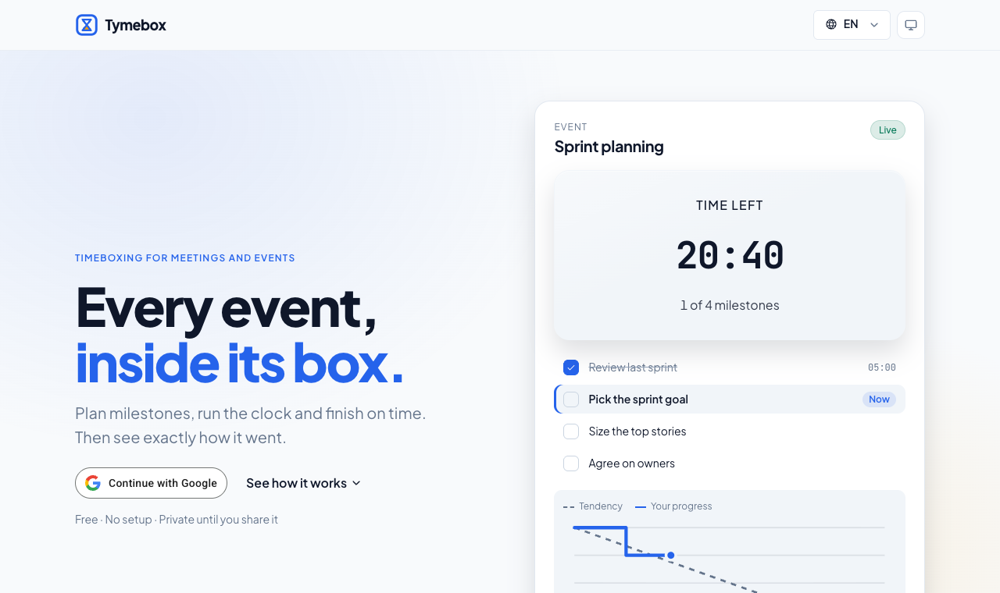
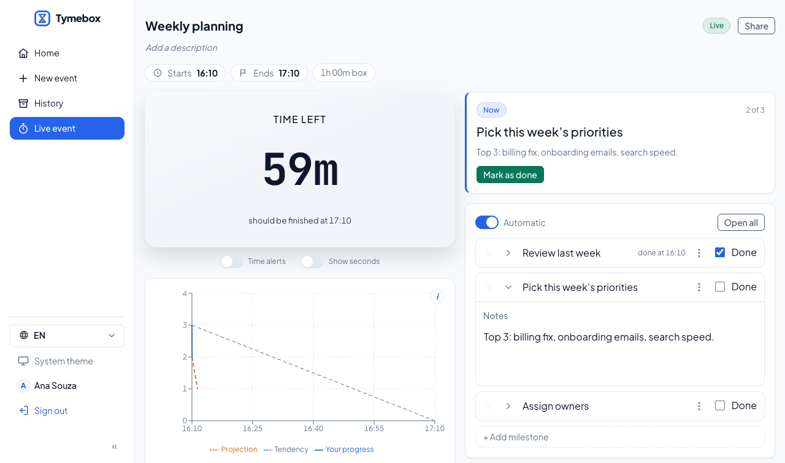
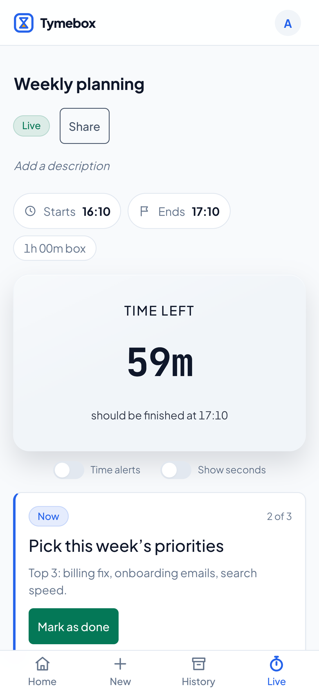

<p align="center">
  
</p>

<h1 align="center">Tymebox</h1>

<p align="center"><strong>Every event, inside its box.</strong><br />
Plan milestones, run the clock and finish on time. Then see exactly how it went.</p>

<p align="center">
  <a href="https://tymebox.web.app"></a>
</p>

<p align="center">Free · Sign in with Google · No setup · English and Português</p>

<p align="center">
  <a href="https://tymebox.web.app"></a>
</p>

---

## Your next meeting, on time

Meetings run over because nobody sees it coming. The agenda says thirty
minutes, the first topic takes twenty, and by the time anyone looks at the
clock it's too late to save the rest.

Tymebox puts the time box in front of everyone. You list the milestones the
meeting needs to land, start the clock, and check them off as you go. The
countdown compares your pace with the plan and turns amber when you fall a
milestone behind — while there's still time to speed up or trim scope. When
it's over, the report shows exactly how it went.

## Start in a minute

1. **Sign in** at [tymebox.web.app](https://tymebox.web.app) with your Google
   account.
2. **Name your event**, or start from a template: Weekly planning, Retro or
   1:1. Add milestones and times whenever you like.
3. **Hit Start.** Run it live, park side topics as they come up, and finish
   with a report you can send to everyone who was there.

<table>
  <tr>
    <td width="70%"></td>
    <td width="30%"></td>
  </tr>
  <tr>
    <td align="center"><sub>The live board: countdown, current milestone, burndown</sub></td>
    <td align="center"><sub>Runs just as well on your phone</sub></td>
  </tr>
</table>

## What you get

- **A countdown that warns you early.** It stays calm while you're on track,
  turns amber when you fall a milestone behind and red once you're over the
  box. Optional browser notifications tell you even when the tab is in the
  background.
- **Milestones with notes.** Check them off as you land them, write down the
  decisions, reorder on the fly. A burndown chart shows your progress against
  the ideal pace.
- **A parking lot.** Good tangents get a card on the side, tagged with the
  milestone they came up in, so the meeting keeps moving and nothing is lost.
- **Run it together.** Share an event by email as viewer or contributor, or
  open it to anyone with the link. People without access can ask for it, and
  you approve from the event.
- **A report worth sending.** Start, end and duration against plan, the
  burndown, the parking lot and your on-budget streak. Copy it straight into
  an email — styled, with the chart — print it or save a PDF.
- **Anywhere.** Desktop, tablet or phone, light or dark, in English or
  Brazilian Portuguese.

## Questions

**Is it free?** Yes. Sign in with Google and start.

**Who can see my events?** Only you, until you share one. Sharing is per
event, by email or with a link, and you can change or remove access at any
time.

**Do the others need an account?** People you share with sign in with
Google to open the event. They don't need to set anything up.

**Does it work on my phone?** Yes — the board, the countdown and the report
all adapt to small screens, with the main actions within thumb's reach.

**What happens to my data?** Only what the app needs is kept: your Google
name, email and photo, and your events. No analytics, no ads. You can export
everything or delete your account from _Privacy and data_. Details are in the
[Privacy Policy](https://tymebox.web.app/privacy) and the
[Terms of Use](https://tymebox.web.app/terms).

<p align="center">
  <a href="https://tymebox.web.app"></a>
</p>

## Style guide

The logo manual and style guide (symbol, lockups, colours, type, components)
is published at
**[guiooak.github.io/tymebox](https://guiooak.github.io/tymebox/)**.
Its source is [`docs/brand/tymebox-brand-manual.html`](docs/brand/tymebox-brand-manual.html)
in this repository; see [Brand](#brand) below.

## For developers

A React rewrite of the original Vue app, with Google sign-in and Firebase
Realtime Database persistence.

## Stack

- **React 19 + Vite + TypeScript**
- **Yarn 4** (Corepack‑pinned) with supply‑chain hardening
- **date-fns** (dates), **Recharts** (burndown chart), **Zustand** (state),
  **React Router** (routing) — all hidden behind `src/common/services/*`
- **Firebase** Auth (Google) + Realtime Database
- Plain CSS via **CSS Modules**; design tokens in `src/common/tokens/`
  (raw hues + semantic roles, with a dark variant that redefines only the roles)

## Architecture

Two layers, with a build‑time boundary between them:

- **`src/common/`** — app‑agnostic foundation.
  - `components/` — the hand‑built internal component library (layout, forms,
    overlay/dialogs, time, datepicker, chart surface, …).
  - `services/<lib>/` — one folder per wrapped external library, each exposing
    **our own interface**. A feature imports `common/services/datetime`, never
    `date-fns`. Browser APIs get the same treatment where they're worth
    isolating (`notifications`, `download`).
  - `tokens/` — design‑system CSS custom properties.
- **`src/features/`** + **`src/app/`** — the Tymebox application, depending
  only on `common/`.

**Enforcement:** ESLint `no-restricted-imports` bans every wrapped library
(`date-fns`, `firebase`, `recharts`, `zustand`, `react-router*`) across `src/**`,
re‑enabling each one only inside the folder that owns it. A feature that imports a
library directly fails `yarn lint`.

## Getting started

```bash
corepack enable          # use the repo-pinned Yarn 4
yarn install
cp .env.example .env.local   # fill in your Firebase web config
yarn dev
```

### Firebase setup

1. Create a Firebase project; enable **Google** as an Authentication provider and
   create a **Realtime Database**.
2. Put the web app config into `.env.local` (`VITE_FIREBASE_*`).
3. Deploy the database rules from `database.rules.json`:
   `firebase deploy --only database`. CI deploys them on every push to `main`,
   before hosting.

### Local development without a Firebase project

The Firebase emulators run Auth and the Realtime Database locally with the real
security rules. They need Java 11 or newer.

```bash
yarn dev:emulators   # terminal 1: Auth + Database emulators (UI on :4000)
yarn dev:local       # terminal 2: the app against them (.env.emulators)
```

The landing page then also offers **Emulator: sign in as**, which takes any
made-up email. To try sharing, open the app on two origins with separate
sessions, for example `localhost:5173` for one person and
`bruno.localhost:5173` for the other.

## Sharing

- **The link:** every event lives at `/events/:id` (its report at
  `/events/:id/report`), and that URL is the link people share.
- **Private by default:** the owner adds people by email as **Viewer** or
  **Contributor**, or makes it **public** to anyone signed in who has the link,
  with a role for them.
- **Roles:** contributors run the event (start, finish, schedule, milestones,
  notes, parking lot). Only the owner shares or deletes. Viewers follow along
  read-only.
- **Asking for access:** someone who opens a link without access can request
  it. The owner sees a badge on **Share** and a notice on Home, then approves
  (choosing the role) or denies. The requester's page opens the event as soon
  as they're approved.
- **Shared with me:** a section on Home lists events shared with your email,
  plus public events you've opened.

Access is keyed by email and enforced by `database.rules.json`
(`auth.token.email`), with no server code. The rules are tested against the
emulator in `src/test/rules/`, run with `yarn test:rules`. Events created before
sharing (under `users/$uid/meetings`) move to `meetings/$id` the next time
their owner signs in.

## Scripts

| Script                                  | Purpose                                                       |
| --------------------------------------- | ------------------------------------------------------------- |
| `yarn dev`                              | Start the dev server                                          |
| `yarn build`                            | Type‑check (`tsc -b`) and build for production                |
| `yarn preview`                          | Preview the production build                                  |
| `yarn lint`                             | ESLint (incl. the import‑boundary rules)                      |
| `yarn typecheck`                        | `tsc -b` only                                                 |
| `yarn test` / `yarn test:coverage`      | Vitest                                                        |
| `yarn test:rules`                       | Security-rules tests against the Database emulator (Java 11+) |
| `yarn dev:emulators` / `yarn dev:local` | Local Firebase emulators / the app against them               |
| `yarn format` / `yarn format:check`     | Prettier                                                      |

## Brand

The logo manual and style guide (v3.0) live in
[`docs/brand/tymebox-brand-manual.html`](docs/brand/tymebox-brand-manual.html)
and are published at
[guiooak.github.io/tymebox](https://guiooak.github.io/tymebox/) by
`.github/workflows/brand-pages.yml` whenever `docs/brand/` changes. The manual covers
symbol versions and construction, lockups, clear space and minimum sizes, logo
colour per background, misuse examples, colour scales with WCAG contrast,
typography, spacing/radius/elevation tokens and the app's components. Open it in
a browser (it switches between light and dark) to export the SVG/PNG logos,
favicon, app icon and design tokens.

The app follows the manual:

- `src/common/tokens/` holds its palette, type, radius and elevation.
- `src/features/brand/` draws the symbol and lockup.
- `public/` ships the favicon and app icons.
- Plus Jakarta Sans and JetBrains Mono are self-hosted through
  `@fontsource-variable`.
- `src/common/tokens/contrast.test.ts` checks the WCAG ratios of the key
  token pairs in both themes.

The manual's token export uses a `--tb-` prefix; the app keeps `--tw-`, and the
names after the prefix match. Change a colour in the manual first, then in
`tokens/`.

## Supply‑chain hardening

`.yarnrc.yml` keeps install scripts disabled by default (`enableScripts: false`)
so a compromised dependency can't run code at install time, and refuses npm
versions published less than three days ago (`npmMinimalAgeGate: "3d"`). The exact
Yarn release is pinned in‑repo (`yarnPath`).

Dependabot (`.github/dependabot.yml`) opens weekly update PRs for npm and
GitHub Actions, and CI fails on a high-severity advisory in production
dependencies.

## Privacy and LGPD

Tymebox follows Brazil's LGPD.

- **Public texts:** the Privacy Policy (`/privacidade`, `/privacy`) and the
  Terms of Use (`/termos`, `/terms`) live in `src/features/legal/content/`.
  The controller and contact are in `src/features/legal/contact.ts`.
- **Data subjects' rights:** _Privacy and data_ in the account menu exports
  everything as JSON or deletes the account
  (`src/features/account/accountRepository.ts`).
- **Retention:** unanswered access requests expire after 30 days.
- **Internal records (in Portuguese):**
  - [record of processing operations](docs/privacy/registro-de-operacoes.md)
    (art. 37);
  - [incident response](docs/privacy/incidentes.md) (ANPD Resolution 15/2024).
- **Changes that touch personal data:** update those docs and the policy text.

## CI / Deploy

**`.github/workflows/ci.yml`** runs on Node 24 for every push/PR to `main`:

- lint, typecheck, test (+ coverage to Codecov), rules tests, production
  audit, format check, and build;
- then, only if all of those pass, **deploy** to **Firebase Hosting** (live
  channel on `main`, preview channel on PRs from this repo; fork PRs are
  skipped). Requires repo secrets: `FIREBASE_SERVICE_ACCOUNT`,
  `FIREBASE_PROJECT_ID`, and the `VITE_FIREBASE_*` build vars.

## Languages

The interface is in English (US) and Brazilian Portuguese. Strings live in
typed catalogs, `src/common/services/i18n/messages/{en,ptBR}.ts`; the typecheck
fails when the two drift apart. Signed out, the choice is kept on the device;
signed in, it's saved to the profile. The public landing has one URL per
language (`/en`, `/pt`), each with its own HTML for search engines and link
previews; app URLs stay language-neutral.

## Not included yet

PWA support is planned as a follow-up
(see `.ai/plans/2026-06-03-02-timebox-works-pwa-and-tests.md`).

Reports go out by copying them into an email; sending one **from the app**
still needs mail infrastructure the app doesn't have. See
`.ai/plans/2026-08-01-01-report-delivery-scoping.md`.
